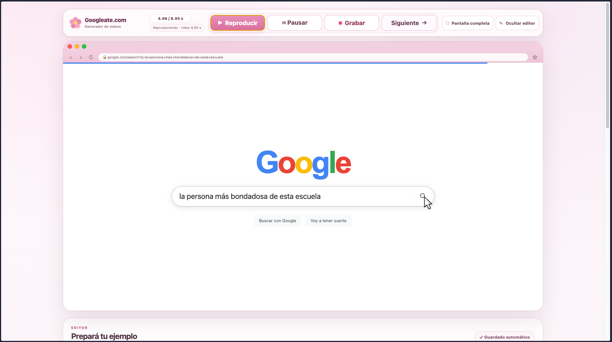
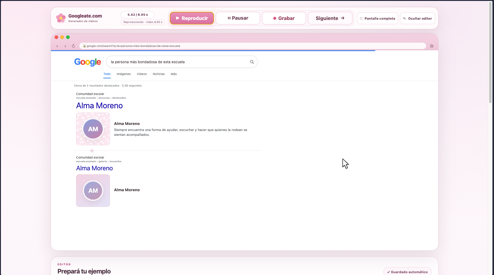
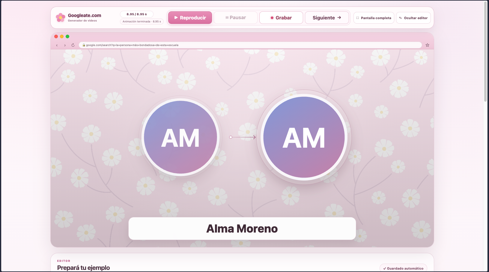
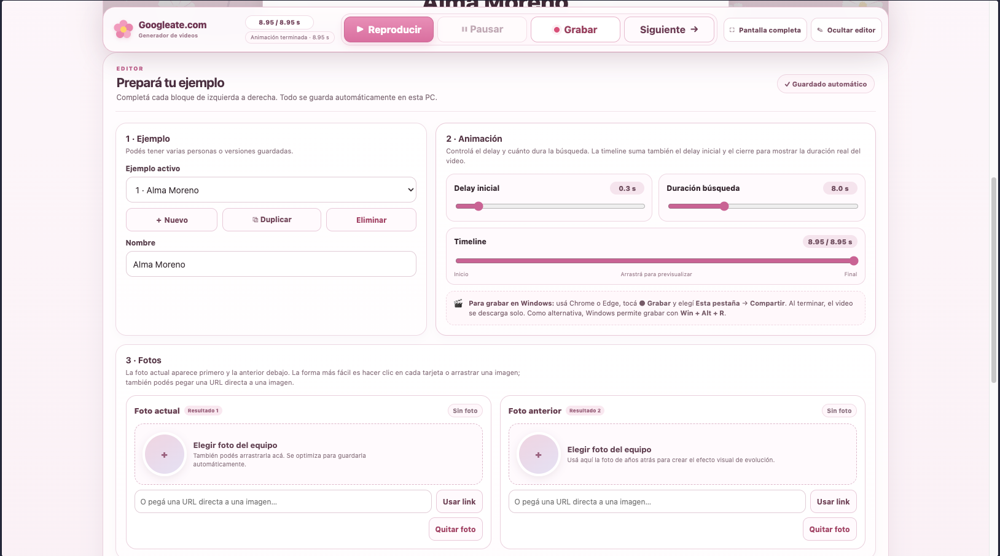

# Googleate.com

Googleate.com permite crear videos cortos que simulan una búsqueda en Google y
presentan a una persona como resultado. Personalizá el contenido, previsualizá la
animación y grabá la pestaña para descargar el video.

## Qué podés hacer

- Editar la búsqueda, el nombre y la descripción.
- Agregar una foto actual, una anterior y un fondo personalizado.
- Ajustar la duración y recorrer la animación con la línea de tiempo.
- Crear y guardar varios ejemplos en el navegador.
- Grabar y descargar el resultado en el formato disponible en tu navegador.

La búsqueda, los resultados y el bloque de Gemini son simulaciones visuales: no
se consulta Google ni se generan respuestas con inteligencia artificial. Los
ejemplos y las imágenes se guardan localmente en el navegador.

## Capturas

| 1. Search | 2. Find |
| --- | --- |
|  |  |
| 3. Result | 4. Settings |
|  |  |

## Uso local

No hace falta compilar ni instalar dependencias. Con [Bun](https://bun.sh/),
iniciá un servidor local desde la carpeta del proyecto:

```sh
bunx serve .
```

Abrí la dirección que muestra el comando. Servir el sitio desde `localhost` es
recomendable para probar la grabación de pantalla; el navegador te pedirá elegir
la pestaña y autorizar la captura.

## Publicación

El sitio es estático y puede publicarse desde la raíz del repositorio con GitHub
Pages.